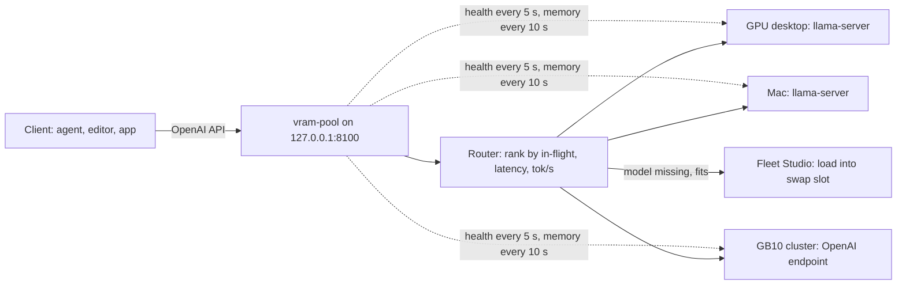

# kodros-vram-pool

One OpenAI-compatible endpoint on `127.0.0.1` in front of every machine in a small fleet that has GPU memory. A client asks for a model; vram-pool sends the request to a machine that already serves it, and loads it into one swap slot when none does.

Part of the [Kodros](https://kodros.ai) local AI stack.

## On your hardware

- Does: puts one endpoint in front of every machine you own that has GPU memory. Clients ask for a model by name and do not need to know which machine serves it.
- Needs: Rust 1.88 to build. The pool itself needs no GPU. You need at least one OpenAI-compatible server behind it (the example uses llama.cpp on CUDA and on Metal). It reads free memory from `nvidia-smi` on NVIDIA hosts, from `sysctl` and `memory_pressure` over SSH on Macs, or from a figure you set for clusters. It has run as a user service on one Linux desktop with an RTX 4080.
- Stays on-prem: it listens on `127.0.0.1` only and refuses any other address, so it serves clients on its own machine unless you add forwarding. The example config points only at loopback and at `192.0.2.0/24`, a documentation range that is never routed. No cloud backend is configured.
- Models: it routes by model name. The example config uses Qwen names as placeholders (Qwen is China-origin). Replace them with the models you run, such as Llama, Gemma or gpt-oss.

## How it works



Static diagram: [docs/architecture.svg](docs/architecture.svg). Step-by-step build: [BUILD.md](BUILD.md).

The router ranks healthy backends that list the requested model and streams the reply back unbuffered. A backend that fails before the first byte is replaced by the next one, up to 3 tries. Each backend has a circuit breaker. Every reply carries `x-vram-pool-device`, `x-vram-pool-backend` and `x-vram-pool-attempts` headers so you can see where it ran.

## Stack

Rust 2024 edition, axum, tokio, reqwest with rustls, TOML config. `unsafe_code = "forbid"`. No database.

## Run

Needs Rust 1.88 or newer.

```sh
cargo build --release
./target/release/vram-pool --init    # writes ~/.config/vram-pool/pool.toml from deploy/pool.toml
./target/release/vram-pool --check   # validates the config
./target/release/vram-pool

curl -s http://127.0.0.1:8100/v1/models
curl -s http://127.0.0.1:8100/v1/chat/completions -H 'content-type: application/json' \
  -d '{"model":"auto","messages":[{"role":"user","content":"hello"}]}'
curl -s http://127.0.0.1:8100/pool/status
```

`model` can be a model id, an alias from the config, or `auto` (fastest healthy chat backend). A status page is at `/status` and Prometheus metrics at `/metrics`. `deploy/vram-pool.service` runs it as a systemd user service.

Replace the example `[[device]]` and `[[backend]]` entries in `deploy/pool.toml` with your own machines. Every setting is listed in [docs/CONFIG.md](docs/CONFIG.md). The JSON and error contract is in [docs/POOL-API.md](docs/POOL-API.md).

Tests: `cargo clippy --all-targets -- -D warnings && cargo test`.

## Status and limits

- Pre-release, version 0.1.0. Runs as a user service on one Linux desktop with an RTX 4080.
- Loopback only. It refuses to start on `0.0.0.0` or any non-loopback address, and there is no client auth beyond the loopback bind and `Host`/`Origin` checks.
- It places whole models on one device. It does not split a model across machines; [research/SHARD-RESEARCH.md](research/SHARD-RESEARCH.md) records what was measured.
- The only write it makes is the one slot swap through Fleet Studio.

## License

Copyright 2026 Tanner Osterkamp. All rights reserved. See [LICENSE](LICENSE). The source is public to read; ask before reuse.
